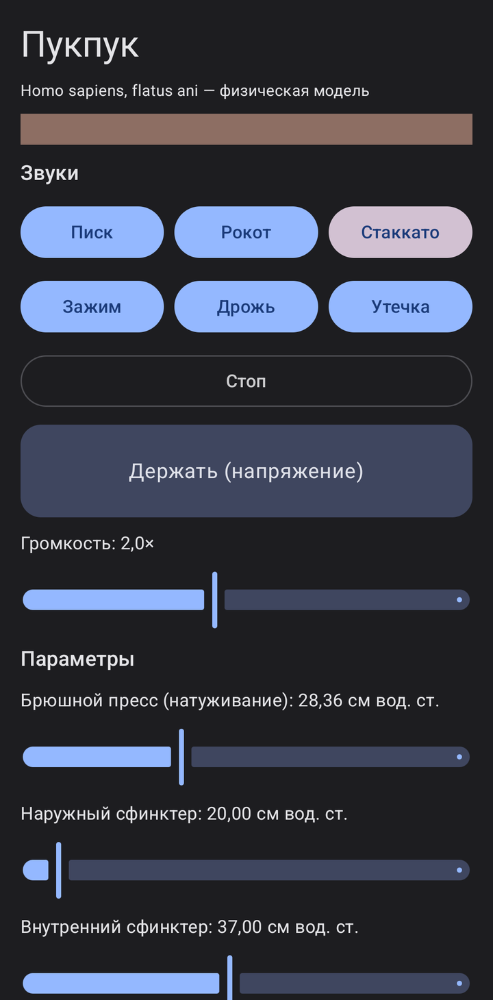
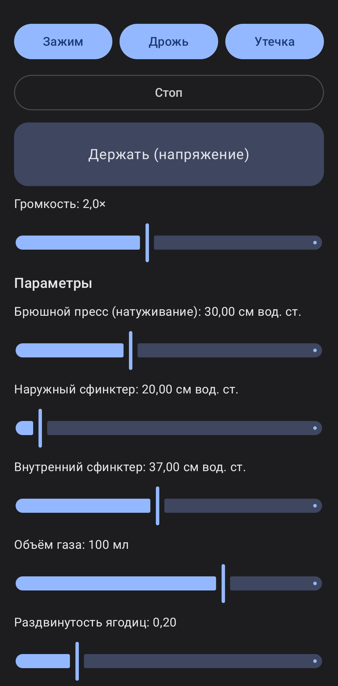
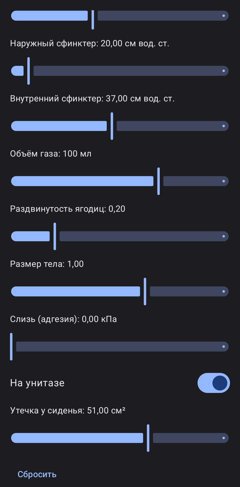

# Пукпук

[](https://github.com/DomenicoCano/Pukpuk/releases/latest/download/Pukpuk.apk)

Шуточное Android-приложение: **физическая модель звука**, который издаёт… задняя точка человека. Это не набор записанных семплов. Звук считается на лету по анатомии и физике: давление и объём газа, работа двух сфинктеров, колебания ягодиц, слизь, форма щели между ягодицами и даже унитаз как резонатор.

Приложение повторяет ПК-версию, потому что использует **тот же движок** ([chimera-vocal-synth](https://github.com/jamesondh/chimera-vocal-synth), Rust), собранный под Android через NDK и JNI. Физика не переписывалась. Интерфейс русский: 6 звуков, кнопка удержания, 9 физических параметров, громкость.

<p align="center">
  
</p>

| Параметры | Режим «На унитазе» |
|---|---|
|  |  |

## Установка

1. Скачайте [`Pukpuk.apk`](https://github.com/DomenicoCano/Pukpuk/releases/latest/download/Pukpuk.apk) со страницы [Releases](../../releases).
2. Откройте файл на телефоне и разрешите установку из неизвестных источников (Android спросит сам).
3. Нажмите «Установить» и запустите «Пукпук».
4. Нажмите любой звук или зажмите «Держать (напряжение)». Если звука нет, проверьте громкость медиа и режим «Не беспокоить».

**Удаление:** обычное удаление приложения, никаких следов в системе оно не оставляет.
Требуется Android 7.0 и новее (arm64, armv7, x86_64).

## Что умеет приложение

- **6 звуков:** Писк, Рокот, Стаккато, Зажим, Дрожь, Утечка.
- **«Держать (напряжение)»:** пока кнопка нажата, затвор открыт; при каждом нажатии набирается новая порция газа, поэтому быстрые повторы тоже звучат.
- **9 параметров** со слайдерами, которые во время звука сами следуют за движком: брюшной пресс, наружный и внутренний сфинктеры, объём газа, раздвинутость ягодиц, размер тела, слизь, сидение на унитазе, утечка у сиденья.
- **Громкость** (по умолчанию 2×, сигнал модели тихий; мягкий ограничитель пиков выше 0,9).
- Индикатор уровня, кнопка «Стоп». Если аудиовыход пропал (смена наушников и т. п.), поток пересоздаётся.

Как это устроено физически: источник звука — анальное кольцо как клапан, открываемый давлением (как губы трубача). Частота нигде не задана, она получается из жёсткости (измеренная податливость канала, сила мышцы) и массы (геометрия). Газовый карман опустошается по ходу звука, поэтому **одно удержание звучит около полусекунды**; чтобы продолжить, отпустите и нажмите снова. Источники констант — в документации исходной модели.

## Что проверено

- Release-сборка (подписана, R8 включён) установлена и запущена на одном телефоне с Android; приложение стартует без падений.
- На устройстве нажаты все кнопки звуков, «Стоп», «Держать» (в том числе четыре быстрых повтора), перетаскивание слайдера, включение «На унитазе», поворот экрана, сворачивание и возврат. Крэшей нет, индикатор уровня и слайдеры реагируют, у аудиотрека нет недогрузов буфера.
- Движок проверен тестами на ПК (`cargo test`, 7 тестов): все 6 звуков и удержание дают конечный сигнал без клиппинга, повторные нажатия звучат, крайние значения параметров безопасны.
- Подпись APK проверена `apksigner`; в APK нет имён, почты и локальных путей сборщика (проверено сканом всех файлов).

## Известные ограничения

- **Звук на слух мной не проверялся**: на тестовом телефоне был беззвучный режим, проверка шла по уровню сигнала, тестам и логам. Автор исходной модели тоже отмечает, что калиброванных акустических исследований нет и «на слух» модель при разработке не слушали.
- Проверено на одном устройстве; другие телефоны и сборки `armv7`/`x86_64` не запускались.
- Нет анатомической анимации (разреза), спектрограммы и сценариев из ПК-версии; есть только индикатор уровня.
- Приложение подписано собственным ключом, не из магазина: Google Play Protect может предупредить об установке.
- Если что-то не работает, откройте [issue](../../issues).

## Сборка из исходников

Нужны Android Studio (или JDK 17+ и Android SDK), Android NDK, Rust и `cargo-ndk`:

```
rustup target add aarch64-linux-android armv7-linux-androideabi x86_64-linux-android
cargo install cargo-ndk
export ANDROID_NDK_HOME=/путь/к/ndk
./gradlew assembleDebug
```

Gradle сам запускает `cargo ndk` (задача `buildChimera`) и кладёт `libchimera_android.so` в `jniLibs`. При сборке домашняя папка подменяется в путях, которые rustc вшивает в библиотеку, поэтому имя пользователя в APK не попадает.
Тесты движка: `cd rust && cargo test -p chimera-android --release`.
Для подписанного релиза создайте `keystore.properties` рядом с `settings.gradle.kts` (в git не попадает) с ключами `storeFile`, `storePassword`, `keyAlias`, `keyPassword` и выполните `./gradlew assembleRelease`. Если путь к проекту содержит не-ASCII символы, в `gradle.properties` уже включён `android.overridePathCheck`.

## Контрольная сумма

SHA-256 релизного `Pukpuk.apk`: `13df6d433df6ce3f1059ee73a3e4685b3f1946309130b9bd12a56c63e690425d`

## Состав репозитория

| Путь | Что это |
|---|---|
| `app/` | приложение на Kotlin и Jetpack Compose |
| `rust/chimera-android/` | JNI-мост к существу `flatulence` и тесты |
| `rust/chimera/` | копия физического движка (MIT) с одним добавлением: `trigger_event` для нового набора газа |
| `docs/` | скриншоты для README |
| `LICENSE` | MIT для кода приложения |

APK в дерево репозитория не коммитится, он лежит только в [Releases](../../releases).

## Важно

Неофициальное приложение, не связанное с авторами chimera-vocal-synth. Шутка и учебный пример физического моделирования звука, не медицинский инструмент.

Движок и модель: [chimera-vocal-synth](https://github.com/jamesondh/chimera-vocal-synth), MIT, © 2026 Jameson Hodge; модель — [PR #66](https://github.com/jamesondh/chimera-vocal-synth/pull/66). Лицензия движка: `rust/chimera/LICENSE`. Код приложения — MIT, см. [LICENSE](LICENSE).
